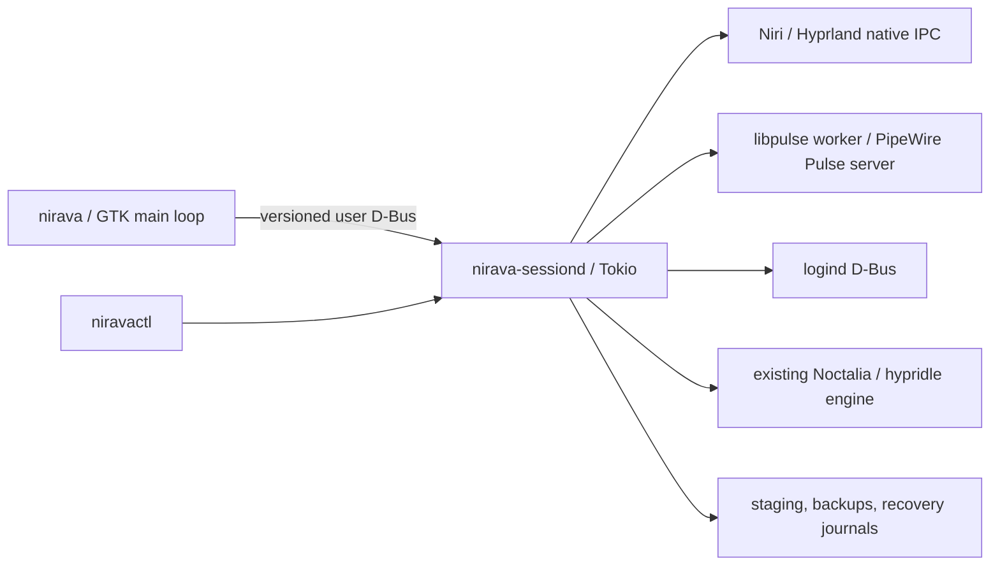

# Nirava implementation plan

## Product decisions

Build an independent native Adwaita app, initially for the Fedora Niri desktop
and Hyprland laptop. Displays, Sound, Power, and System are the first pages.
NetworkManager, BlueZ, and Input follow later. Generic Sway/Mango/River/
Wayfire/labwc support follows verified native backends; GNOME and KDE are not
initial targets.

Retain Noctalia on Niri and hypridle plus the current locker on Hyprland.
Retain kanshi monitor profiles on the laptop. Guided setup must preview exact
changes, preserve unrelated text, back up originals, and offer Restore.
Migrating direct hypridle startup into a managed user service is an optional
later integration requiring explicit consent. No new idle engine in v1.

These choices supersede the original Grok proposal's new idle daemon, generic
display-protocol assumptions, three-second lock timeout, and replacement of
kanshi. A timer or successful command exit is not proof of a secure lock.

## Architecture

- `nirava-core`: serializable domain models, config editors, guarded file transactions.
- `nirava-backends`: discovery, native compositor adapters, audio, logind, preview watchdog.
- `nirava-service`: versioned user-bus interface; all mutations are explicitly gated.
- `nirava-ui`: GtkBuilder/Adwaita shell; asynchronous backend worker, no device work on GTK's thread.
- `nirava-cli`: diagnostics, review, commit, recovery, and acceptance-test commands.

Pinned dependency resolution is in Cargo.lock. GTK 4.12/libadwaita 1.6 are
minimum native versions; Rust bindings are gtk4 0.11/adw 0.9. Audio uses
libpulse-binding 2.30 against PipeWire's Pulse compatibility service. zbus 5
handles user D-Bus and logind. No privileged daemon or arbitrary-shell RPC.

## Config and display transactions

Read → stage → parse/validate → show exact changes → explicit Apply → recheck
source hash → timestamped backup → atomic replacement → reload → readback.
Restore refuses a file edited since Nirava wrote it and verifies backup hashes.
Hash checks reduce races; an external writer is not made cooperative by them.
Parent symlinks and multi-file crash atomicity need further hardening before
integration is released.

Niri runtime changes use native IPC. A complete layout must retain at least
one enabled head, use advertised modes, identify the same physical outputs,
and respect supported scale/transform/VRR. A 15-second backend watchdog is
armed before apply. Pending state is journaled first and recovered on restart.
New hotplug heads are retained on rollback. A supervised service is required.

Persistence is a separate step. The KDL writer preserves spans outside edited
output nodes and comments; duplicate output definitions are refused. Guided
integration may extract matching blocks into one managed include, with
multi-file backup/recovery. Existing output rules must not be duplicated.
Included configuration graphs must be resolved before offering Save.

Hyprland/kanshi support must edit the selected existing kanshi profile, preserve
selectors and unrelated profiles, and validate against the installed versions.
Do not introduce a competing monitor writer. Display Save remains unavailable
until reload, crash recovery, hotplug, and login persistence checks pass.

## Power and audio

Noctalia's supported idle actions are imported from its existing TOML file.
Unknown custom behaviors remain intact; duplicate owners are refused.
Hypridle integration must preserve lock_cmd, before_sleep_cmd, after_sleep_cmd,
and nonstandard listeners. Unsupported custom scripts are displayed for review,
not silently rewritten. Caffeine is supported only where the existing owner
has verified logind-inhibitor support.

Noctalia lock-and-suspend is permitted only with an enabled lockscreen and a
verified secure-lock path. Hypridle inhibit_sleep=3 uses compositor lock-ready
notification; a fixed sleep is not an acceptable substitute. Never suspend,
hibernate, reboot, or log out from an automated acceptance test.

Audio inventory and mutations run on one native worker. Preserve channel
balance, handle device/server disappearance, identify stale targets, subscribe
to changes, and verify writes. v1 includes default sink/source, volume, mute,
and playback-stream controls. Pro Audio routing remains outside scope.

## Milestones and acceptance

| Milestone | Required result | Status |
|---|---|---|
| M0 foundation | Workspace, domain model, read-only discovery, native window demo | Native demo and read-only discovery passed; launcher/laptop checks pending |
| M1 sound | Native build, real inventory matches wpctl, defaults affect new streams, mute/volume verified | Native worker built and real inventory read; hardware mutation checks pending |
| M2 power | Existing-engine import/edit/reload/Restore; caffeine effective; human lock/suspend test | Noctalia implementation written; engine/hardware acceptance pending |
| M3 display preview | Editor, apply, 15-second revert, process-kill/restart recovery, unplug/replug | Editor/dialog built; fake-driver recovery tests pass; supervised hardware checks pending |
| M4 persistence/setup | Include/profile integration, exact diff, validation, multi-file recovery, Restore | Pure Niri KDL writer only |
| M5 laptop | Hypridle + kanshi integration; manual Hyprland tests with external display | Read-only Hyprland discovery only |
| M6 release | Native CI, packaging, accessibility, documentation, all v1 gates | Packaging definitions and safe checks in progress |

## Upstream references and comparable projects

References used during design; source-repository analysis did not require
decompiling installed software.

- [Niri output configuration](https://yalter.github.io/niri/Configuration:-Outputs.html)
- [Niri IPC](https://yalter.github.io/niri/IPC.html)
- [Noctalia native source](https://github.com/noctalia-dev/noctalia)
- [Hypridle](https://wiki.hypr.land/Hypr-Ecosystem/hypridle/)
- [kanshi](https://gitlab.freedesktop.org/emersion/kanshi)
- [ReSet](https://github.com/Xetibo/ReSet) and [ReSet-Plugins](https://github.com/Xetibo/ReSet-Plugins)
- [nwg-displays](https://github.com/nwg-piotr/nwg-displays)
- [nwg-shell-config](https://github.com/nwg-piotr/nwg-shell-config)

ReSet is the closest broad Rust/GTK settings reference; Nirava keeps its own
implementation so display transactions and existing-engine integration can
be designed around these two machines. Review upstream licenses before copying
code. No external code has been vendored into this project.
